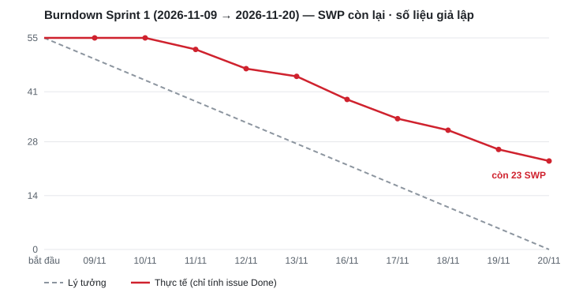

# Báo cáo tiến độ — Sprint 1 (giả lập)

- **Iteration trên Project:** `Sprint 1`
- **Khoảng thời gian giả lập:** 2026-11-09 (thứ Hai) → 2026-11-20 (thứ Sáu), 10 ngày làm việc
- **Ngày chốt báo cáo:** 2026-11-20, cuối ngày
- Mọi số liệu tiến độ, giờ thực tế và người phụ trách là **giả lập** (PREMISE G-07). Nguồn: [`tools/sprint-1-progress-data.mjs`](tools/sprint-1-progress-data.mjs); SWP lấy từ báo cáo skill; trạng thái giống hệt Project.

**Tóm tắt cho khách:** Sprint 1 xong 32/55 SWP (58%). Phần nền (chợ, vai trò, ngày nghiệp vụ 02:00, lịch chợ, bảng phiên bản quy tắc) đã xong và có test. Còn 23 SWP chuyển sang Sprint 2, trong đó RPC phiên bản quy tắc (#18) đang review. Công thức 完納奨励金 chờ quý công ty trả lời 6 câu hỏi (#49); cần câu trả lời trước 2026-12-04 để không ảnh hưởng Sprint 4. Nếu tốc độ giữ như Sprint 1 thì Release 1 trễ khoảng 3 sprint; Sprint 2 sẽ cân lại tải để bù (xem rủi ro R2, R4).

## 1. Trạng thái

Phạm vi Sprint 1: 12 issue, 55 SWP (165 giờ ước lượng).

| Trạng thái | Số issue | Tổng SWP | Ghi chú |
|---|---:|---:|---|
| Done | 8 | 32 | #9, #10, #11, #13, #14, #16, #17, #27. Giờ ước 96, thực tế 105 (+9%) |
| In Review | 1 | 10 | #18: review phát hiện thiếu kiểm "bản đổi biểu phí phải hiệu lực ngày 1 của tháng" (PREMISE P-03). Đã dùng 26/30 giờ |
| In Progress | 2 | 10 | #28 (bảng giấy phép, 10/18 giờ); #12 (seed, chờ #28) |
| Blocked | 1 | 3 | #49: gửi khách 6 câu hỏi ngày 11/11, khách hẹn trả lời 27/11 |
| Todo | 0 | 0 | |
| **Tổng Sprint 1** | **12** | **55** | Hoàn thành 58% theo SWP |
| Backlog các sprint sau | 48 | 246 | Sprint 2〜6, Todo |

Theo người (giờ ước lượng được giao / năng lực 60 giờ): BE-1 87 / 60, BE-2 57 / 60, QA-1 12 / 60, BrSE 9 / bán thời gian, FE-1 và FE-2 **0** / 60.

## 2. Burndown

| Ngày | Lý tưởng (SWP còn lại) | Thực tế (SWP còn lại) |
|---|---:|---:|
| bắt đầu | 55 | 55 |
| 09/11 | 49.5 | 55 |
| 10/11 | 44 | 55 |
| 11/11 | 38.5 | 52 |
| 12/11 | 33 | 47 |
| 13/11 | 27.5 | 45 |
| 16/11 | 22 | 39 |
| 17/11 | 16.5 | 34 |
| 18/11 | 11 | 31 |
| 19/11 | 5.5 | 26 |
| 20/11 | 0 | 23 |

Chỉ issue **Done** mới trừ vào SWP còn lại; issue đang làm dở không tính phần trăm, để đường thực tế không đẹp hơn sự thật.

**Thực tế lệch kế hoạch ở đâu**
- **Hai ngày đầu đứng yên:** cả hai BE cùng làm migration nền (#9, #10), không có gì xong. Kế hoạch giả định việc xong đều mỗi ngày nên đường lý tưởng tách ngay từ đầu.
- **Tải dồn vào một người:** BE-1 nhận 87 giờ trên năng lực 60 giờ, làm thêm ~21 giờ vẫn còn #18 và #28. Hai FE không có việc trong sprint vì toàn bộ phạm vi Sprint 1 là DB/RPC. Đây là lỗi lập kế hoạch, không phải lỗi thực hiện.
- **Migration bị ước thấp:** #27 thực tế 24 giờ / ước 18 giờ (bảng map dữ liệu cũ phải hỏi BrSE); #13 12 / 9 giờ (6 chỗ gọi hàm cũ không có trong mô tả issue).
- **Phần đã xong thì khớp ước lượng:** 8 issue Done lệch +9% tổng; các issue không phải migration lệch trong khoảng ±10%.

## 3. Rủi ro trễ tiến độ

Dự báo: tốc độ Sprint 1 là 32 SWP/sprint. Còn 269 SWP ⇒ ~8.4 sprint nữa, so với 5 sprint còn trong kế hoạch, tức **trễ ~3 sprint nếu không thay đổi gì**. Nếu đưa 2 FE vào việc từ Sprint 2 (R4), năng lực lý thuyết ~50 SWP/sprint ⇒ ~5.4 sprint, vẫn trễ ~1 sprint. Hai con số này báo cáo cùng nhau, không chỉ đưa con số tốt.

| Rủi ro | Issue | Ảnh hưởng tới mốc nào | Hành động | Ai làm, khi nào |
|---|---|---|---|---|
| R1 Khách chưa trả lời công thức 完納奨励金 (FIN-02, thuế 8% hay 110/100) | #49 → #53 (#54〜#59), #60 | Engine 奨励金 ở Sprint 4 (bắt đầu 2026-12-21); mốc kết thúc phát triển (Sprint 6, 2027-01-31) | Làm trước #50〜#52 vì không phụ thuộc công thức. Nhắc khách 25/11. Nếu chưa có trả lời ngày 04/12: xin khách xác nhận bằng văn bản đồng ý giả định G-01〜G-06 | BrSE nhắc 2026-11-25; PM xin xác nhận 2026-12-04 |
| R2 BE-1 quá tải, việc nền dở dang chặn chuỗi giấy phép | #18, #28 → #29, #30, #19, #12 | Kết thúc Sprint 2 (2026-12-04): #29, #30 có nguy cơ trượt sang Sprint 3 | Chuyển #28 sang BE-2; BE-1 chỉ giữ #18 tới khi merge. Planning Sprint 2: không ai được giao > 60 giờ | TL/PM trong planning 2026-11-23 |
| R3 Issue migration dữ liệu bị ước thấp (+33% ở #27) | #28, #43, #68 | Sprint 2 và Sprint 4 | Từ Sprint 2 cộng 20% giờ cho issue có chữ ký `data-migration` khi lên kế hoạch (không sửa SWP); chấm lại sau 2 sprint (estimate.md mục 2) | TL, 2026-11-23 |
| R4 FE không có việc ở Sprint 1, việc UI dồn về Sprint 3〜5 | #15, #20, #21, #31 | Sprint 3〜5 quá tải FE, kéo theo mốc kết thúc phát triển | Kéo #15, #20 lên đầu Sprint 2 (API của #14, #17 đã có); FE làm khung màn #21 song song với #18 | PM, planning 2026-11-23 |
| R5 Seed chờ bảng giấy phép → test DB các BR mới thiếu dữ liệu | #12 (chờ #28) | Kiểm thử các issue Sprint 2 | Seed theo từng phần: merge phần đã có, phần giấy phép merge cùng #28 | QA-1, 2026-11-25 |
| R6 Thiếu kiểm "ngày 1 của tháng" ở #18 lọt sang production sẽ làm sai 奨励金 kỳ có đổi biểu phí | #18, #56 | Đúng đắn của số tiền 奨励金 (không phải mốc thời gian) | Không merge #18 khi chưa có test cho P-03; thêm ca này vào bộ test vector #59 | BE-1 sửa trước 2026-11-24; QA-1 thêm ca vào #59 |

## Từ viết tắt và mã dùng trong file này

| Viết tắt / mã | Nghĩa |
|---|---|
| SWP | Standard Work Point — điểm khối lượng công việc chuẩn của skill `tkm:sun-estimate`. Mỗi issue chấm 2 trục: Scope (độ rộng: số màn, bảng, lớp) và Complexity (độ khó bên trong: trạng thái, thuật toán, migration, rủi ro vận hành); SWP tra từ bảng nhân cố định Scope × Complexity. Thang: rất dễ 1–2, dễ 3–5, vừa 6–12, khó 13–25, rất khó 26+. Không phải giờ: bài này quy 1 SWP = 3 giờ |
| FIN-01, FIN-02 | Mã câu hỏi nhóm tài chính trong bảng hỏi RFP của LAB-1. FIN-01: ngày thanh toán lấy từ đâu (trả lời giả định: nhập tay hoặc import CSV). FIN-02: chi tiết công thức 完納奨励金 (trả lời giả định: kỳ tháng, tỷ lệ theo bậc doanh số, hạn N ngày) |
| BR-xxx-nn | Business Rule — mã quy tắc nghiệp vụ dùng chung từ LAB-1/LAB-4 (ví dụ BR-INC-01 công thức 完納奨励金, BR-RULE-01 Maker ≠ Checker và tối đa 4 lần/năm, BR-PERM-01 tư cách người mua) |
| P-nn / G-nn / H-nn | Mã dòng trong PREMISE.md của LAB-5: P = spec sửa so với LAB-4, G = giả định bổ sung, H = hướng đã chốt. Issue trỏ ngược về các mã này |
| #nn | Số issue trên GitHub (ví dụ #7 = epic 完納奨励金, #53 = engine tính) |
| R1〜R6 | Mã rủi ro trễ tiến độ trong progress-report.md |
| BE / FE / QA | Backend / Frontend / Quality Assurance (kiểm thử). BE-1, FE-2, QA-1… là vai trò giả định trong đội, không phải người thật |
| BrSE | Bridge System Engineer — kỹ sư cầu nối, làm việc trực tiếp với khách Nhật |
| PM / TL | Project Manager / Tech Lead |
| RPC | Remote Procedure Call — ở đây là hàm trong Postgres (Supabase) mà API gọi tới; quy tắc nghiệp vụ cần nguyên tử nằm trong RPC (ADR-002 LAB-4) |
| DB | Database — cơ sở dữ liệu (Postgres trên Supabase) |
| UI | User Interface — giao diện màn hình |
| API | Application Programming Interface — ở đây là Route Handler của Next.js mà màn hình gọi |
